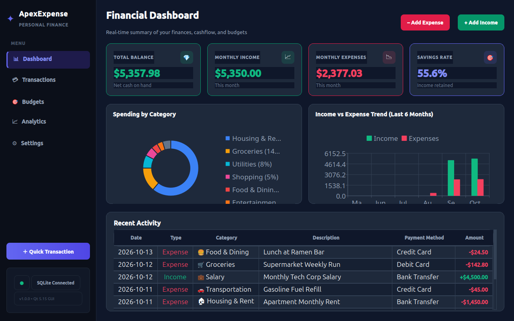

# ✦ ApexExpense — Modern Qt C++ Expense & Finance Tracker

ApexExpense is a desktop personal finance and expense tracking application built in modern C++17 with Qt 5. It features a dark slate user interface, interactive charts, category budgeting, and comprehensive import/export support across industry-standard formats.



---

## ✨ Key Features

- **Executive Financial Dashboard**
  - KPI Metric Cards: Real-time **Net Balance**, **Monthly Income**, **Monthly Expenses**, and **Savings Rate %**.
  - **Category Spending Donut Chart** (QtCharts): Hover slices, glowing category colors, and percentage breakdown.
  - **6-Month Cashflow Bar Chart** (QtCharts): Side-by-side comparison of Income vs. Expenses.
  - **Recent Activity Ledger**: Quick preview of your latest transactions with color-coded status pills.

- **Comprehensive Transactions Management**
  - Add, edit, clone, and delete transactions with confirmation prompts.
  - Dynamic type filtering (Expenses vs. Incomes).
  - Multi-criteria filtering: Text search, Date presets (Today, Week, Month, Year, Custom Range), Category, and Payment Method.
  - Interactive table with category badge pills, emojis, and formatted currency amounts.

- **Monthly Category Budgets**
  - Set and adjust spending limits for individual categories.
  - Live progress bars with dynamic color stages:
    - 🟢 **Emerald**: Under 75%
    - 🟠 **Amber**: 75% – 99%
    - 🔴 **Rose/Red**: 100%+ (⚠️ *Over Budget warning badge*)
  - Month-by-month historical budget tracking and overall monthly budget summary.

- **Financial Analytics & Insights**
  - Daily average spending metric across chosen period.
  - Top expense category share & largest recorded transaction.
  - Payment method usage distribution (Credit Card, Debit, Cash, Transfer, Crypto, etc.).

- **Multiple File Formats & Data Portability**
  - **SQLite Database (`.db`)**: Embedded relational database for storage with ACID compliance.
  - **CSV Export & Import (`.csv`)**: Standard RFC 4180 format for banking/spreadsheet workflows (Excel, Google Sheets). Automatically resolves and creates missing categories during import.
  - **JSON Backup & Restore (`.json`)**: Complete hierarchical data backups preserving categories, budgets, and all transaction metadata with merge/replace options.
  - **Executive HTML Reports (`.html`)**: Beautiful, self-contained financial reports formatted with CSS styling, ready for viewing or printing to PDF.

- **Modern & Beautiful GUI**
  - Custom QSS theme (Dark Slate `#0F172A` with `#1E293B` elevated cards).
  - Color-coded financial indicators (Emerald `#10B981`, Rose `#F43F5E`, Indigo `#6366F1`).
  - Toast notifications for feedback on user actions.
  - Configurable currency symbols (`$`, `€`, `£`, `¥`, `₹`, `CHF`, `kr`).

---

## 📁 File Formats Supported

| Format | Purpose | Details |
|---|---|---|
| **SQLite (`expenses.db`)** | Primary Database | Automatic table creation, foreign keys, migrations, located in app data directory. |
| **CSV (`.csv`)** | Spreadsheet Export / Import | Columns: `ID,Date,Time,Type,Category,Amount,PaymentMethod,Description,Notes`. |
| **JSON (`.json`)** | Full System Backup / Restore | Hierarchical tree with application metadata, categories, budgets, and transactions. |
| **HTML (`.html`)** | Printable Reports | Standalone report with print CSS, executive summaries, KPI tables, and transaction ledgers. |

---

## 🛠️ Required Packages & Dependencies

The project relies on Qt 5 and SQLite:
- `qtbase5-dev` (Qt Core, Widgets, Gui)
- `qtbase5-dev-tools` (moc, rcc, uic)
- `libqt5charts5-dev` (Qt Charts)
- `libqt5sql5t64` & `libqt5sql5-sqlite` (Qt SQLite driver)
- `libqt5svg5-dev` (Qt SVG module)
- `cmake` (>= 3.16)
- `g++` / `clang++` with C++17 support

On Debian/Ubuntu systems, install via:
```bash
sudo apt-get update
sudo apt-get install -y cmake g++ qtbase5-dev qtbase5-dev-tools libqt5charts5-dev libqt5svg5-dev libqt5sql5-sqlite
```

---

## 🚀 Quick Start (Build & Run)

### 1. Build the Application
Run the automated build script:
```bash
./build.sh
```
Or manually with CMake:
```bash
mkdir -p build
cmake -B build -S . -DCMAKE_BUILD_TYPE=Release
cmake --build build -j$(nproc)
```

### 2. Launch the Application
Run the launcher script:
```bash
./run.sh
```
Or launch the executable directly:
```bash
./build/ApexExpense
```

---

## ⌨️ Keyboard Shortcuts

- `Ctrl + N`: Open Quick Transaction dialog
- `Ctrl + 1`: Go to Dashboard
- `Ctrl + 2`: Go to Transactions Ledger
- `Ctrl + 3`: Go to Budgets
- `Ctrl + 4`: Go to Analytics & Insights
- `Ctrl + 5`: Go to Settings & Backup

---

## 📂 Project Architecture

```
first/
├── CMakeLists.txt                 # CMake configuration with embedded RPATH
├── build.sh                       # One-command build script
├── run.sh                         # Runtime launcher
├── resources/
│   ├── app.qrc                    # Qt resource compilation file
│   └── styles/
│       └── modern_dark.qss        # Premium dark QSS stylesheet
└── src/
    ├── main.cpp                   # Application entry point & configuration
    ├── models/
    │   ├── Category.h             # Category data struct
    │   ├── Transaction.h          # Transaction data struct
    │   └── Budget.h               # Budget data struct
    ├── database/
    │   ├── DatabaseManager.h      # SQLite persistence layer & queries
    │   └── DatabaseManager.cpp
    ├── utils/
    │   ├── CurrencyFormatter.h    # Currency symbol & sign formatter
    │   ├── CurrencyFormatter.cpp
    │   ├── CsvHandler.h           # CSV RFC 4180 export & import
    │   ├── CsvHandler.cpp
    │   ├── JsonHandler.h          # Full JSON backup & restore
    │   ├── JsonHandler.cpp
    │   ├── HtmlReportGenerator.h  # Executive HTML printable report generator
    │   └── HtmlReportGenerator.cpp
    └── ui/
        ├── MainWindow.h           # App shell with sidebar navigation
        ├── MainWindow.cpp
        ├── views/
        │   ├── DashboardView.cpp  # Overview, charts, KPI cards, recent activity
        │   ├── TransactionsView.cpp # Filterable ledger, search, CSV tools
        │   ├── BudgetsView.cpp    # Monthly category limits & progress bars
        │   ├── AnalyticsView.cpp  # Breakdown, payment methods, HTML export
        │   └── SettingsView.cpp   # Currency, backup, custom categories
        ├── dialogs/
        │   ├── TransactionDialog.cpp # Modal for add/edit transaction
        │   ├── BudgetDialog.cpp      # Modal for category budget limits
        │   └── CategoryDialog.cpp    # Modal for custom category creation
        └── components/
            ├── MetricCard.cpp        # Modern elevated stat card
            ├── ToastNotification.cpp # Animated auto-dismissing banner
            └── CategoryPill.cpp       # Category badge with color & emoji
```
